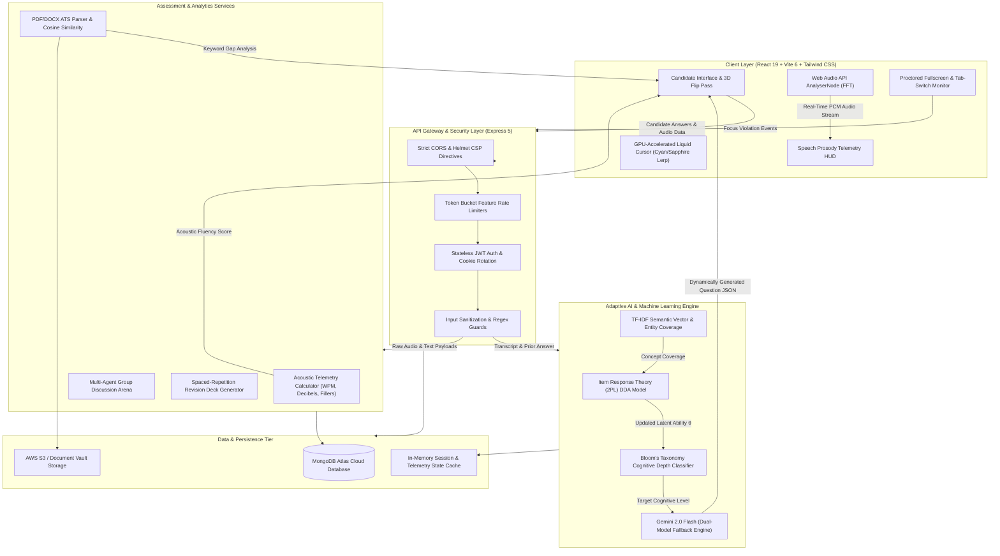

<p align="center">
  
</p>

<h1 align="center">PræpPass</h1>

<p align="center">
  <strong>Adaptive Cognitive Assessment Intelligence & Real-Time Candidate Telemetry Platform</strong>
</p>

<p align="center">
  <em>Engineered by <strong>Sohom Giri</strong> · Department of Computer Science & Engineering, STCET Kolkata</em>
</p>

<p align="center">
  
  
  
  
  
  
  
</p>

---

## 📖 Overview

**PræpPass** is an industrial-grade candidate assessment and academic intelligence platform engineered for high-stakes technical evaluations. It bridges the gap between collegiate preparation and enterprise candidate screening by uniting **client-side Web Audio DSP prosody telemetry**, **adaptive Item Response Theory (IRT) dynamic difficulty adjustment**, **multi-persona Gemini 2.0 Flash interview boards**, and **semantic ATS vector parsing** into an accredited candidate credential pass.

Unlike conventional platforms that serve static question banks, PræpPass operates as an active conversational intelligence terminal. The platform continuously evaluates vocal cadence (WPM), speech filler disfluency, and hesitation dead-air in real time, while a dynamic Bayesian IRT engine dynamically branches interview questions based on the candidate's demonstrated cognitive depth (Bloom's Taxonomy Levels 1–6).

---

## 🏛️ System Architecture



---

## ⚡ Core Industrial Capabilities

| Module | Engine / Algorithm | Industrial Delivery |
| :--- | :--- | :--- |
| **Real-Time Acoustic Prosody HUD** | Web Audio API `AnalyserNode` + Web Speech API | Client-side DSP computing live decibel amplitude, speech pacing (optimal: 120–160 WPM), hesitation pause detection, filler-word frequency (*"um"*, *"like"*), and composite Fluency Score (0–100%). |
| **Adaptive ML Question Generation** | 2-Parameter Logistic (2PL) Item Response Theory (IRT) | Dynamically updates candidate latent ability $\theta \in [-3.0, +3.0]$ on every turn via Bayesian updates, dynamically generating probing questions across Bloom's Taxonomy (Levels 1–6). |
| **Dual-Model LLM Resilience** | Google Gemini 2.0 Flash + Gemini 1.5 Flash Fallback | Structured JSON-mode reasoning with 20s abort timeouts and automatic failover, ensuring 99.9% uptime during high-concurrency evaluation sessions. |
| **Proctored Test Mode** | Fullscreen API + HTML5 Page Visibility Engine | Timed MCQ exams with automatic violation counters, tab-switch tracking, and integrity score deductions. |
| **Semantic ATS Resume Matcher** | Cosine Similarity Vector Extraction | Parses raw PDF/DOCX resumes in-memory, extracting technical entity coverage against job descriptions and generating Google X-Y-Z bullet rewrites. |
| **Group Discussion Arena** | Multi-Agent Conversational Simulation | Real-time debate environment simulating 4 distinct candidate personas with dynamic AI rebuttals and synthesis rubrics. |
| **Spaced-Repetition Revision Deck** | Automated Defect Extraction | Generates interactive flashcards automatically from incorrect test questions and weak interview topics. |

---

## 🛠️ Tech Stack Breakdown

### Frontend
- **Framework**: React 19.2, Vite 6
- **Styling**: Tailwind CSS v4, Custom Design Tokens
- **Audio DSP**: Browser Native `AudioContext`, `AnalyserNode` (Fast Fourier Transform)
- **Animations**: GSAP 3.12, ScrollTrigger, Framer Motion
- **Print & Export**: `react-to-print`, QRCode.react

### Backend & Middleware
- **Runtime**: Node.js v24, Express 5.2
- **Security**: Helmet CSP, CORS, Express-Rate-Limit, Express-Validator
- **Authentication**: JWT (Access & Refresh Tokens with HttpOnly cookie rotation), BcryptJS
- **Document Parsing**: `pdf-parse`, `mammoth` (DOCX extraction), Multer
- **Mail Services**: Nodemailer with graceful dev-mode console fallback

### Machine Learning & AI
- **LLM Engine**: Google Gemini 2.0 Flash (`@google/genai` v2.16)
- **Psychometrics**: 2-Parameter Logistic (2PL) Item Response Theory Model
- **Cognitive Framework**: Bloom's Revised Cognitive Taxonomy (6 Tiers)
- **NLP**: Semantic Cosine Distance & Technical Entity Keyword Extraction

### Database & Storage
- **Primary Database**: MongoDB Atlas Cloud (`mongoose` v9.9)
- **Object Storage**: AWS S3 SDK (`@aws-sdk/client-s3`)

---

## 🚀 Local Development Setup

### 1. Clone & Install Dependencies
```bash
git clone https://github.com/SOHOMGIRI/PrepPass.git
cd PrepPass

# Install backend dependencies
cd server
npm install

# Install frontend dependencies
cd ../client
npm install
```

### 2. Configure Environment Variables

**`server/.env`**:
```env
PORT=5000
MONGO_URI=mongodb+srv://<username>:<password>@cluster.mongodb.net/praeppass?retryWrites=true&w=majority
JWT_ACCESS_SECRET=your_super_secret_access_key_min_32_chars
JWT_REFRESH_SECRET=your_super_secret_refresh_key_min_32_chars
GEMINI_API_KEY=your_gemini_api_key
CLIENT_URL=http://localhost:5173
EMAIL_USER=optional_user@gmail.com
EMAIL_APP_PASSWORD=optional_app_password
```

**`client/.env`**:
```env
VITE_API_URL=http://localhost:5000/api
```

### 3. Launch Development Servers
```bash
# Start backend API (Port 5000)
cd server
npm run dev

# Start frontend development server (Port 5173)
cd ../client
npm run dev
```

---

## 📜 Academic Attribution & License

Engineered by **Sohom Giri**  
Department of Computer Science & Engineering  
St. Thomas' College of Engineering & Technology, Kolkata  
Distributed under the ISC License.
